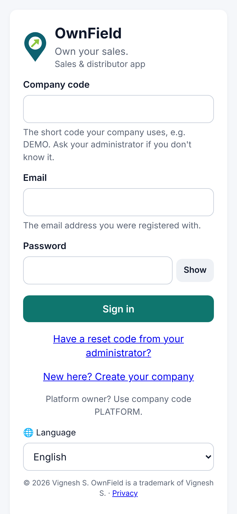

<p></p>

# OwnField

**Own your sales.**

Open-source, **industry-agnostic** field sales and distributor management for FMCG, pharma, retail and consumer durables, apparel, and services companies. It's meant as a self-hostable alternative to commercial field-force SaaS tools.

**License:** AGPL-3.0-only (see `LICENSE`, `NOTICE`). **Trademark:** the OwnField name and logo are not covered by the code licence — see `TRADEMARKS.md`.

> OwnField was previously called FieldForce OSS. Internal identifiers (database names, env vars, package names, `X-FieldForce-*` webhook headers) keep the old name for compatibility.
**Hosted version:** free up to a fixed number of users per company. The platform owner sets each company's user limit. Admins see a warning at 80% of the limit, and new users are blocked once the limit is reached. You can self-host it with no limits.

## Step 1 features
- Multi-company with tenant isolation: every query is scoped to the company in the signed-in user's token.
- Login with company code + email + password. The platform owner uses the code `PLATFORM`.
- Roles: platform owner, company admin, manager, sales rep, distributor.
- Per-company user limit set by the platform owner: warning at 80%, blocked at the limit.
- Excel/CSV upload for **shops**, **products** (style, SKU, size, HSN, MRP, billing price) and **users**. Uploads add new rows or update existing ones, and errors are reported per row.
- Mobile-first React PWA with admin pages (users, shops, products, import, platform companies).

## Step 2 features
- **Beat/route plans:** managers create ordered shop routes and assign them to sales reps. Reps see only their own beats.
- **Visits with GPS check-in/out:** coordinates are required. A rep can have only one open visit at a time.
- **Order taking with a size grid per style:** prices come from the billing price. Orders are saved in an **offline queue** in the PWA and synced automatically. The server ignores repeats of the same order (`clientRef`), so retries never create duplicates.
- **Distributor mapping:** set per shop in the UI, or with the `Distributor Email` column in the shop upload. Orders go to the mapped distributor's **inbox**, where they can be accepted, rejected, or marked fulfilled.
- **Manager dashboard:** visits, orders and order value by rep and day for the last 1, 7 or 30 days. Days use `REPORT_TZ`, default Asia/Kolkata.

## Step 3 features (industry-agnostic)
- **Industry templates chosen at setup:** Apparel, FMCG, Pharma, Retail/Consumer durables, Services or Custom. A template presets features, variant attributes, units and custom fields. Admins can change all of it later in **Settings**, or re-apply a template.
- **Configurable product model:** item → variants with company-defined attributes (size/colour, pack size/flavour, strength/form, model/colour, plan…). Each item has units with conversions (e.g. `PCS=1|BOX=12|CASE=144`, `STRIP=1|BOX=10`), and each variant has its own MRP and billing price. Orders store the unit, the quantity and the base-unit quantity.
- **Pharma:** stock carries batch number + expiry. Orders are allocated **first-expiry-first-out (FEFO)** when accepted, and expired batches are never allocated. Outlets and distributors can carry an optional drug licence number.
- **Services:** non-stock items (service visit, AMC…) are never stock-checked.
- **Feature toggles per company:** stock tracking, batches, size-grid ordering, GPS check-in, schemes, drug licence, service items. The app adapts to them. For example, the size grid appears only for items whose variants differ by attribute; other items get a simple quantity + unit list.
- **Custom fields** on outlets, products and visits (text / number / date / select, optionally required). They're validated on import, on the API and in the visit check-out form.
- **Schemes:** percentage discount above a minimum base quantity, for one item or for all items.
- **Stock:** per distributor or company stock. Orders are checked against sellable stock when placed and allocated when accepted.
- **Excel/CSV import adapts** to each company's attributes, units and custom fields. Each import has a downloadable template. Stock upload sets the quantity per SKU/batch/location.
- **A sample dataset per template** (Settings → Load sample data). Every record is fictitious and named "Sample …".

## Step 4 features
- **GST invoices** from accepted or fulfilled orders:
  - Each line's GST rate comes from its HSN/SAC code: the company sets a default rate plus a rate per code prefix, and the longest matching prefix wins.
  - **CGST + SGST** apply when the outlet's state (state code or GSTIN) matches the company's; otherwise **IGST** applies.
  - Totals are rounded to the rupee and the round-off is shown.
  - Numbers are gapless and **restart every financial year (April–March)**. The format is configurable (`{prefix}/{fy}/{seq:4}`, at most 16 characters).
  - Invoices print as a tax invoice with an HSN summary.
- **Returns / credit notes** against an invoice line: tax is reduced in proportion, you can't return more than was invoiced, and you can optionally **put the goods back into the same batches** they were allocated from.
- **Targets vs achievement:** monthly targets per rep for order value, order count and visits. Set them in the UI or import them from Excel/CSV. Managers see the whole team; reps see their own progress.
- **Visit photos:** reps take photos during a visit. Photos are shrunk on the phone to at most 1280 px, only JPEG/PNG/WebP is accepted (the file content is checked), and there's a limit of 10 per visit. They're stored on disk (`UPLOAD_DIR`, a Docker volume) and visible only to the rep who took them and to managers.
- **Excel/CSV report exports:** orders (line level), visits (with custom fields and photo counts), GST register (invoices and negative credit notes), stock, and targets vs achievement.
- **Database transactions:** placing an order, accepting it (with first-expiry-first-out stock allocation), invoicing, and credit notes with restocking each commit as one transaction or roll back completely. Stock and document numbers are also protected by compare-and-set updates.

## Step 5 features
- **(a) Purchase orders (distributor → company).**
  - The distributor drafts a PO, then submits it, which gives it a number `PO/<FY>/<seq>` that runs separately for each distributor.
  - The company approves it, optionally changing quantities or overriding a price (a reason is required and every override is logged), or rejects it with a reason.
  - Dispatches can be partial. When the company tracks stock, goods are picked from company stock first-expiry-first-out, and their batch and expiry carry through when the distributor receives them into their own stock.
  - Each PO can be printed or exported to CSV/Excel.
  - **Pricing:** start from the price base (billing price or MRP, set per company), take off the margin % (company default, can be overridden per distributor), then any product/category discount %, then the distributor's discount %. GST is charged on the final rate.

- **(b) Distributor billing** (a toggle per company). Distributors invoice their own orders under their own GSTIN, legal name and address, with their own invoice and credit-note numbering. Every document belongs to one issuer: the company or a single distributor. Each issuer sees and credits only its own documents, while the company can view all of them. When the toggle is on, the company can't invoice orders that belong to a distributor.

- **(c) Schemes.** Four types: percent off, flat ₹ off per unit, buy X get Y free, and quantity or value slabs. Each can be limited to a product, category, distributor or date range. The best price scheme is applied to each order line automatically, and buy-X-get-Y adds free lines at ₹0. Invoices carry the same scheme pricing and free goods. The rep app previews savings before the order is placed (`POST /api/orders/preview`). The scheme-cost report (`/api/reports/schemes`) shows the discount given plus the value of free goods for each scheme.

- **(d) Collections.**
  - **Outstanding:** tracked per outlet for each issuer (the company or a billing distributor) as invoices − credit notes − payments, with advances shown separately.
  - **Payments:** cash, UPI, cheque or NEFT (UPI, cheque and NEFT need a reference). Each payment is allocated FIFO or against the invoices you choose.
  - **Receipts:** printable, numbered `RCPT/<FY>/<seq>` per issuer.
  - **Cheque bounce:** reverses the allocations, so the invoices re-open, and the receipt is marked bounced.
  - **Credit terms:** credit days and credit limit are set per company under Settings, and an outlet can override them with `PATCH /api/shops/:id {creditDays, creditLimit}`. A breach either warns (the order is placed with `creditWarning`) or blocks the order (409).
  - **Ageing report:** buckets of 0-30, 31-60, 61-90 and 90+ days, exportable to Excel or CSV.
  - **Rep app:** a Collect tab and an inline credit warning on the order form.

- **(e) E-invoicing** (a toggle per company, plus a provider setting).
  - **JSON:** builds NIC e-invoice schema **v1.1** JSON for invoices (INV) and credit notes (CRN, linked to the original invoice), B2B only, with UQC unit mapping (`GET /api/invoices/:id/einvoice/json`).
  - **Provider interface:** `EinvProvider` with two adapters:
    - **TEST mock:** fake IRN (sha256) and QR, marked *TEST — NOT VALID FOR GST* in the payload and on the print.
    - **GSP stub:** reads `EINV_GSP_BASE_URL`, `EINV_GSP_CLIENT_ID`, `EINV_GSP_CLIENT_SECRET`, `EINV_GSP_USERNAME` and `EINV_GSP_PASSWORD`. Returns 503 if they are missing and 501 otherwise. Connect your GSP there.
  - **Printed invoice:** shows the IRN, acknowledgement number and date, and the QR code.
  - **Cancellation:** allowed within 24 hours of generation, with a NIC reason code.
  - **No real API calls are made.**

> GST rates in the industry templates are **samples**. Verify the rate for every HSN/SAC code with your tax advisor. E-invoicing (IRN/QR) and e-way bills are not included yet.

## Phase 3 features (each is a company feature toggle in Company settings)
- **Store checks (audits)** — admin builds checklists (yes/no, number, text, photo questions); reps fill them during a visit and add shelf photos; managers see a report with scores and photos.
- **Expenses** — reps claim an amount with a category and a bill photo; managers approve or reject (with a reason); monthly summary per rep and category.
- **Leave & attendance** — reps apply for leave; managers approve; on approved leave days the beat shows "on leave" and check-ins are paused; monthly attendance (days worked / on leave).
- **Incentives** — admin sets simple rules: reach X% of a target → earn ₹Y (highest step counts); reps see "earned this month" on their home screen.
- **Retailer app** — a `retailer` login linked to one outlet (users sheet: Role `retailer` + `Shop Code`) can browse products, place orders that go to its distributor's inbox, and see its order history.

Photos are shrunk on the phone (about 1280px JPEG) before upload; the server accepts images up to 1 MB (`PHOTO_MAX_BYTES`).
On start the server adds labelled sample data for these features to the company with code DEMO only, if missing.

## Field operations (each is a company feature toggle; DEMO has sample data for all)

- **Van sales**: load a van, sell and print the invoice on the spot, count and close the day (van stock is its own ledger).
- **Distributor inventory**: stock per distributor with a movement log (receipts, sales, adjustments).
- **Claims**: distributors claim damage/scheme amounts; approve, part-approve or reject; settle with a credit note (CCN-…).
- **Two-way sync**: through Integrations (connectors push events, pull masters).
- **Barcode / QR**: scan with the phone camera (BarcodeDetector) or type the code.
- **Leads**: prospects with follow-ups, converted into outlets.
- **Location trail & geofence**: light GPS pings while the rep app is open (working hours, 30 days kept); check-in warns when far from the outlet.
- **Coverage**: planned vs visited outlets per rep and beat.
- **Languages & offline**: English, Hindi, Tamil, Kannada (picked per phone); lists are cached and orders, payments, van sales, visits and surveys are queued offline and deduped on the server.
- **Surveys**: build forms (text, number, yes/no, choice, competitor price); competitor price report.
- **WhatsApp / SMS**: mock provider by default — messages are only logged. Real sends happen only after an admin sets an HTTP gateway URL and key.

## Built-in AI (no API key needed)

Works out of the box from your own order history — rules and simple statistics, no outside calls.
- **Smart order suggestions** (rep, Take order → Add products): products and quantities from the outlet's past orders and reorder cycle, must-sell items, what similar outlets buy, capped to stock on hand. Each has a one-line reason and a one-tap **+ Add** (or **Add all**). API: `POST /api/ai/suggest {shopId}`.
- **Daily summary** (manager/admin Home): yesterday and today in plain sentences — orders and value vs the 7-day average, planned vs done visits, top and lowest reps, unusual orders, shops ordering less, low-stock risk. API: `GET /api/ai/summary`.
- **Shops at risk**: outlets whose order gap is much longer than usual, or whose orders have dropped. API: `GET /api/ai/at-risk`.

Optional: to have an LLM re-word the summary into a short paragraph, set `AI_PROVIDER=openai-compatible`, `AI_BASE_URL` (e.g. `https://api.openai.com/v1` or a local Ollama `http://localhost:11434/v1`), `AI_MODEL` and `AI_API_KEY`. Only the summary sentences are sent; the facts and numbers always come from the built-in rules. If the call fails, the built-in sentences are shown.

## Custom reports (build your own, no code)

Admins and managers open **Reports → + New report**: pick the data (orders, order lines, visits, beat plan vs visits, attendance,
collections, outstanding/ageing, returns, invoices, stock, outlets, sales reps), dates (today … this financial year, or custom),
filters (rep, distributor, outlet, area, beat, product, category, plus simple conditions), up to two group-by fields (or day/week/month),
numbers (count, total, average, lowest, highest, distinct count), sort, and a view (table, bar, line, pie, KPI card). The preview updates live.
Compare with the previous period or the same period last year. Save, name, share with managers / sales reps / distributors
(reps and distributors only ever see their own rows), pin to the home dashboard, download Excel/CSV.
**Ready-made** reports (sales by rep / distributor / product / category, daily trend, visits planned vs done, productive calls,
collections ageing and by mode, at-risk outlets) can be copied and edited. The old fixed exports are under **Standard exports**.

**Scheduled email** is stored per report (daily / weekly / monthly at an India-time hour). When due, the file is written to
`REPORT_OUTBOX` (default `server/data/report-outbox/<company>/`). Nothing is emailed unless `SMTP_HOST` is set **and** the optional
`nodemailer` package is installed (`npm i -w server nodemailer`); also `SMTP_PORT`, `SMTP_USER`, `SMTP_PASS`, `SMTP_FROM`, `SMTP_SECURE=1`.
Turn the scheduler off with `REPORT_SCHEDULES_DISABLED=1`.

**Safe by design.** Users never write SQL. A report is JSON naming a source, field keys and options; the server checks every key against a
whitelist, runs fixed SQL with the company id and bound parameters, then groups in code. Limits: `REPORT_MAX_ROWS` (50 000 rows loaded),
5 000 rows returned, `REPORT_TIMEOUT_MS` (20 s, also a Postgres `statement_timeout`), `REPORT_RUNS_PER_MIN` (60 per user), 200 saved reports per company.

**API** (JWT): `GET /api/report-builder/catalog`, `POST /api/report-builder/preview {def}`, `POST /api/report-builder/export?format=csv|xlsx {def,name}`,
`GET|POST /api/custom-reports`, `GET|PUT|DELETE /api/custom-reports/:id`, `PATCH /api/custom-reports/:id/pin`, `GET /api/custom-reports/:id/run?preset=`,
`GET /api/custom-reports/:id/export?format=`, `GET /api/custom-reports/:id/json`, `GET /api/custom-reports/export` (all, JSON),
`POST /api/custom-reports/import` (`{reports:[{name, description, def, roles}]}`), `POST /api/custom-reports/from-template/:key`, `GET /api/custom-reports/pinned`.

A definition looks like:
```json
{ "version": 1, "source": "orders", "filters": { "dateRange": { "preset": "this_month" }, "rep": [12] },
  "conditions": [{ "field": "status", "op": "neq", "value": "rejected" }], "groupBy": ["rep"],
  "metrics": [{ "fn": "sum", "field": "value" }, { "fn": "count" }], "columns": [], "sort": { "by": "sum_value", "dir": "desc" },
  "view": { "type": "bar" }, "compare": "prev" }
```

### Adding a data source or field (developers)
Everything lives in `server/src/reports/`: `sources.ts` (data sources), `engine.ts` (validation, grouping, comparisons),
`templates.ts` (ready-made reports), `routes.ts` (API), `schedule.ts` (scheduled delivery).
1. In `sources.ts` add an entry to `SOURCES`: a fixed `sql` that ends in `WHERE <table>.company_id=$1` (and, if it has dates,
   `AND <col>>=$2 AND <col><$3`; set `dateKind` to `"ts"` for timestamps or `"text"` for `YYYY-MM-DD` columns, and `dateField`).
   Never build SQL from user input.
2. List `fields`: `key: col("Label", "text" | "number" | "money" | "date" | "bool", "sql_alias")` or `f("Label", type, row => value)` for computed values.
3. Map standard filters in `dims` (`rep`, `distributor`, `shop`, `area`, `beat`, `product`, `category`) to the SQL column; sales reps and
   distributors are restricted through `rep` / `distributor`, so a source without them can't be shared with those roles.
4. Optional: `enrich()` to add computed values with extra company-scoped queries, or `load()` to build rows in code (see `beat_plan`).
5. Add the new labels to `web/src/locales/en.json` (and other languages), add a test in `server/test/reports.test.ts`.

## Data workspace (SQL for your own developers / data team)

**Setup → Data workspace** gives company admins, and people an admin marks as **data analysts** (Access tab), a read-only SQL editor
with a schema browser (tables, columns, notes). Join tables, aggregate, and **save a query as a dataset**: it then appears in the report
builder as a data source (`SQL: <name>`), so it gets charts, KPI cards, comparisons (if it has a date column), pinning, Excel/CSV and schedules.

**Isolation and safety (three layers):**
1. **Company views.** Each company gets a schema `ff_c<companyId>` with one view per allowed table (`orders`, `order_lines`, `shops`, `users`,
   `items`, `variants`, `stock`, `beats`, `beat_shops`, `visits`, `rep_days`, `invoices`, `invoice_lines`, `payments`, `payment_allocations`,
   `targets`, `schemes`, `expenses`, `leaves`, `leads`, `claims`, `purchase_orders`). Each view is filtered by that company id; secret columns
   (password hashes, TOTP secrets, API keys, webhook secrets, connector settings, photo files) are never in a view. Child tables are filtered through their parent.
2. **SQL guard** (`server/src/workspace/guard.ts`). Exactly one `SELECT` / `WITH … SELECT`. Blocks DDL/DML (`INSERT`, `UPDATE`, `DELETE`, `DROP`,
   `CREATE`, `ALTER`, `COPY`, `SET`, `GRANT`, `SELECT INTO`, `FOR UPDATE` …), multiple statements, `$` quoting, `pg_*` / `information_schema` /
   `public` / other companies' schemas, non-workspace tables, and any function not on an allow-list (so no `pg_read_file`, `dblink`, `lo_*`,
   `set_config`, `pg_sleep` …). Table names are rewritten to the company schema.
3. **Database.** Each run is a `READ ONLY` transaction with `statement_timeout` (`WORKSPACE_TIMEOUT_MS`, 15 s), `search_path` set to the company
   schema, and a row cap (`WORKSPACE_MAX_ROWS`, 5 000; `WORKSPACE_RUNS_PER_MIN`, 30). When the app's database user has `CREATEROLE`, the query also
   runs `SET LOCAL ROLE ff_ro_c<id>` (**strong mode**): a NOLOGIN role that can only `SELECT` that company's views (no base tables, no
   other schemas, no file functions, no writes). The schema endpoint and the workspace page report `isolation: "role+views"` (strong) or `"views"`.
   Strong mode switches on by itself when the database allows it, in either of two ways:
   - **Least privilege (hosted server, recommended):** the app's DB user gets no extra rights. As the Postgres superuser run
     `deploy/db-privileges.sql` (`psql -v app=<app db user> -f deploy/db-privileges.sql`, safe to re-run). It creates a NOLOGIN role
     `ff_ws_provisioner` that only has `CREATEROLE`, and makes the app user a NOINHERIT member of it. The app switches to it
     (`SET LOCAL ROLE`) only for the statements that create the per-company roles. On PostgreSQL 16+ such a role can only manage roles it
     created and can never create superusers. The hosted EC2 server applies this automatically on every update (`deploy/server-hook.sh`).
   - **Simple:** `ALTER ROLE <app db user> CREATEROLE;` (the default Docker setup already uses the superuser, so it is strong out of the box).
   Disable with `WORKSPACE_DB_ROLES=0`; a different provisioner role name with `WORKSPACE_PROVISIONER_ROLE`.

Every query, including refused ones, is written to the security audit log (`workspace.sql` / `workspace.sql_refused`, with the SQL, rows and time);
admins see it under **Query log**.

**BI tools (Power BI, Tableau, Metabase, Superset)** — optional, **off by default**, needs strong mode. An admin turns it on under
Data workspace → Access; the app creates login `ff_bi_c<id>` with a random password (**shown once**, never logged or stored by the app),
`default_transaction_read_only=on`, `search_path=ff_c<id>`, a connection limit (`WORKSPACE_BI_CONN_LIMIT`, 3) and `statement_timeout`; it
can read only that company's views. "Make a new password" replaces it; turning it off sets `NOLOGIN`.

The admin also enters the **allowed IP addresses** (the public IP of the BI server or gateway; single IPs or networks no wider than /16
(IPv4) or /48 (IPv6); `0.0.0.0/0` is refused). The database is **never open to the world**:
- *Hosted EC2 server:* outside connections are off unless `BI_DB_EXPOSE=1` in `deploy/options.env` (default `0`; change it by a commit).
  When on, `fieldforce-oss-bi-sync` (root timer, every 2 min, installed by `deploy/server-hook.sh`) writes one
  `hostssl <db> ff_bi_c<id> <ip> scram-sha-256` rule per allowed IP of each company whose BI login is on, turns on TLS with the server's
  Let's Encrypt certificate (TLS 1.2+), and listens on port `BI_DB_PORT` (5432) only while at least one rule exists. No other user or
  database can connect from outside, and connections without TLS are refused. **You must also add an inbound rule to the AWS security group:**
  TCP 5432 from each allowed IP (`x.x.x.x/32`) only — never `0.0.0.0/0`. The app shows whether the server accepts BI connections.
- *Docker / your own server:* the default compose file does not publish the database. If you need it, publish 5432 only on a firewall that
  allows the BI IPs, set `ssl=on`, and add `hostssl <db> ff_bi_c<id> <ip>/32 scram-sha-256` lines to `pg_hba.conf` (see `docker-compose.yml`).

Connection details (shown with the password): host = your server name (`WORKSPACE_BI_HOST`, defaults to the site's host name), port 5432
(`WORKSPACE_BI_PORT`), database (`WORKSPACE_BI_DATABASE`, defaults to the app database), user `ff_bi_c<id>`, schema `ff_c<id>`, SSL required.
- **Power BI Desktop:** Get data → PostgreSQL database → Server `host:5432`, Database `<db>` → Import or DirectQuery → Database login with
  the user and password → pick tables under `ff_c<id>`. Keep "Encrypt connections" on. For the Power BI service, use an on-premises data
  gateway and allow the gateway machine's public IP.
- **Tableau Desktop / Server / Cloud:** Connect → To a Server → PostgreSQL → Server `host`, Port `5432`, Database `<db>`, Authentication
  "Username and Password", tick **Require SSL** → Sign In → Schema `ff_c<id>`. For Tableau Cloud, allow Tableau Cloud's published IP
  addresses for your pod (or use Tableau Bridge and allow the Bridge machine's IP).
- **Metabase:** Admin → Databases → Add → PostgreSQL → host, port, database name, username, password, "Use a secure connection (SSL)" on,
  "Only these schemas" → `ff_c<id>`.
- **Superset:** Settings → Database Connections → + Database → PostgreSQL → SQLAlchemy URI
  `postgresql://ff_bi_c<id>:<password>@host:5432/<db>?sslmode=require`; in Advanced → SQL Lab leave DML off.

**API** (JWT, admin or analyst): `GET /api/data-workspace/schema`, `POST /api/data-workspace/query {sql, limit}`, `GET|POST /api/data-workspace/datasets`,
`PUT|DELETE /api/data-workspace/datasets/:id`, `GET /api/data-workspace/me`; admin only: `GET|PUT /api/data-workspace/analysts {userIds}`,
`GET /api/data-workspace/history`, `GET|PUT /api/data-workspace/bi-access {enabled}`, `PUT /api/data-workspace/bi-allowlist {ips}`. Datasets are used in report definitions as `"source": "ds:<id>"`.
To expose another table or column, add it to `server/src/workspace/tables.ts` (never secret columns) and extend `server/test/workspace.test.ts`.

## Stack
Node 20 + TypeScript + Express + PostgreSQL. React + Vite on the front end. Tests use Vitest + Supertest against in-memory Postgres (pg-mem).

> Pre-1.0: the database schema may still change between steps. Recreate the database when upgrading.

## Self-host
```bash
OWNER_EMAIL=you@example.com OWNER_PASSWORD=strong JWT_SECRET=random docker compose up -d --build
# open http://localhost:8080 , sign in with company code PLATFORM
```

### Photo storage and disk space

All photos (visit photos, day-start selfies, store audit photos, expense bills) go through one photo store.

| Variable | Default | Meaning |
|---|---|---|
| `PHOTO_STORAGE` | `local` | `local` = files in `UPLOAD_DIR`; `s3` = an S3-compatible bucket (AWS S3, Cloudflare R2, MinIO, Wasabi…) |
| `UPLOAD_DIR` | `./uploads` | Folder for local photos (a Docker volume). If `./uploads` is not writable by the app, photos go to `~/uploads` of the service user |
| `S3_BUCKET` | – | Bucket name (required for `s3`) |
| `S3_REGION` | `us-east-1` | Bucket region (`auto` for R2) |
| `S3_ENDPOINT` | AWS | Custom endpoint for non-AWS providers, e.g. `https://<account>.r2.cloudflarestorage.com` |
| `S3_ACCESS_KEY_ID` / `S3_SECRET_ACCESS_KEY` | – | Keys with read + write on the bucket (required for `s3`) |
| `S3_PREFIX` | – | Optional folder inside the bucket |
| `DISK_ALERT_PCT` | `15` | Warn when free disk is below this % |
| `AI_PROVIDER` | (empty) | Empty = built-in rules only. `openai-compatible` = also re-word the manager summary with an LLM |
| `AI_BASE_URL`, `AI_MODEL`, `AI_API_KEY` | (empty) | OpenAI-compatible endpoint, model and key (used only when `AI_PROVIDER` is set) |
| `TEMP_DIR` | `<tmp>/ownfield` | Temp folder; files older than a day are removed hourly |

If `s3` is chosen but a value is missing, the server logs it and keeps using local disk. After switching, old local photos still open (reads fall back to disk).
Every hour the server checks free disk: below `DISK_ALERT_PCT` it logs `LOW DISK` and shows a red banner to the platform owner and company admins. The hourly cleanup only deletes old files in `TEMP_DIR` — never photos, backups or the database.

## Develop
```bash
npm install
npm test                 # API tests
npm run demo -w server   # in-memory demo with SAMPLE data on :8080 (run `npm run build -w web` first)
npm run dev -w web       # Vite dev server proxying /api
```
Local `npm run demo` logins (in-memory sample data only): `PLATFORM / owner@example.com / demo`, `DEMO / admin@example.com / demo`, `DEMO / rep@example.com / changeme123`. The hosted demo is by request at [ownfield.in](https://www.ownfield.in).

Upload templates are in `sample-data/`. All sample data there is made up.

## Roadmap
Next (proposed): offline photo queue, a real GSP adapter for e-invoicing (needs your GSP credentials), and e-way bills.

## UI walkthrough (mobile)



| Login | Rep home | New order | Admin home |
|---|---|---|---|
|  |  |  |  |

Screenshots use the in-memory DEMO company (`npm run demo -w server`). All of its data is sample data.

## Security & privacy
- Sign-in: per-IP rate limit and per-account lockout (5 failures → 15 min), optional TOTP two-step sign-in (admins can require it), optional one-phone binding for sales reps, idle sign-out (default 60 min, per company), one-time admin reset codes (plug a mailer in with `setMailer()`).
- Tokens are revoked at once when a user is disabled, deleted, or changes/resets their password.
- Helmet headers (HSTS, CSP, frame deny, nosniff), same-origin CORS (`CORS_ORIGINS` to allow more), app binds to `127.0.0.1` (`HOST` to change), `trust proxy` = 1.
- Activity log of sign-ins, alerts (new device/IP, failures, lockouts) and admin changes under **Security & privacy**; data export (JSON/CSV) and user/company deletion by anonymisation; privacy notice at `/privacy.html`.
- Nightly gzip `pg_dump` at 02:30 into `~/backups` (7 kept; `BACKUP_DIR`, `BACKUP_KEEP`, optional `BACKUP_S3_BUCKET`).

## Copyright & trademark

© 2026 Vignesh S. OwnField is a trademark of Vignesh S.

SPDX-License-Identifier: AGPL-3.0-only. You may use, change and share the code under the AGPL. You may not use the OwnField name or logo for your own product or service without permission; see [TRADEMARKS.md](TRADEMARKS.md).
